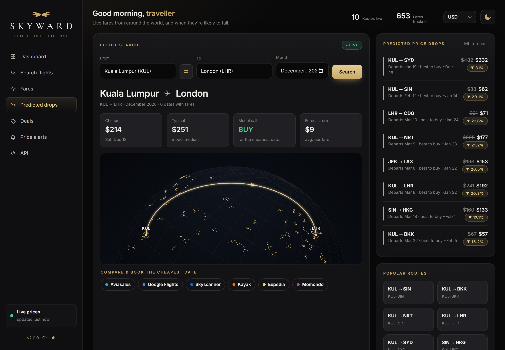

<div align="center">

# ✈ Skyward

**Live flight prices, ML fare forecasts and price alerts: know when to book.**

[](https://skyward-tv5y.onrender.com)
[](https://github.com/Faryaan-Khan/skyward/actions/workflows/ci.yml)
[](https://github.com/Faryaan-Khan/skyward/actions/workflows/refresh.yml)


[](LICENSE)

[**Open the live site →**](https://skyward-tv5y.onrender.com) &nbsp;·&nbsp; [API docs](https://skyward-tv5y.onrender.com/docs)



</div>

Search flights between any two cities in the world, see live fares in your own currency, compare the
big booking sites in one click, and let machine learning tell you *when* to book. A gradient-boosted
model predicts what a fare will cost on every day between now and departure, so you get a clear
**BUY / WAIT** call, the expected lowest price and the best day to buy, and a feed of fares it expects
to **drop**. Set a watch and Skyward notifies you by email or Telegram when it's time.

> The live site runs on Render's free plan. A [cron-job.org](https://cron-job.org) job pings it every
> 10 minutes so it stays awake and keeps refreshing prices; GitHub Actions also pings it as a backup.

## Tech stack

| Layer | Tools |
| --- | --- |
| API & web | FastAPI, Uvicorn, vanilla JS + Chart.js |
| Data | PostgreSQL (Neon) via SQLAlchemy, SQLite for local dev |
| ML | scikit-learn `HistGradientBoostingRegressor`, pandas, NumPy |
| Live prices | Travelpayouts / Aviasales Data API |
| Hosting & automation | Render; GitHub Actions runs the tests on every push and deploys to Render only when they pass |

## Features

- **Worldwide search**: type any city or airport (autocomplete covers every IATA code). The cheapest
  real fare for each date of the month appears in seconds; routes people search are then refreshed
  automatically every 15 minutes.
- **Compare & book**: every date links straight to the same search on Aviasales, Google Flights,
  Skyscanner, Kayak, Expedia and Momondo. Skyward never takes payments; you book on the airline's or
  agency's own site.
- **Any currency**: prices shown in 160+ currencies with daily exchange rates; your choice is remembered.
- **Predicted price drops**: the model scans live fares and highlights the ones it expects to get
  cheaper, by how much, and the best day to buy.
- **Buy-or-wait advice**: sweeps every possible purchase day and reports the expected low, the best
  buy date and the model's error band (MAE on a held-out split).
- **Deals**: real fares more than 15% under the model's expected price for that route and date.
- **Private price alerts**: each watch gets a secret manage token kept in the visitor's browser, so
  nobody can see anyone else's watches or email address. Alerts go out at most once a day per watch.
- **Luxury dashboard**: dark charcoal and gold with an animated great-circle flight path on a globe,
  plus a day mode (the sun/moon toggle morphs and the page cross-fades). Works on phones.
- **REST API** with interactive docs at `/docs`.

## Architecture (built to scale)

```
 GitHub Actions (every 15 min)        Render web service (N workers / instances)
 ┌────────────────────────┐           ┌──────────────────────────────────────────┐
 │ wake site +            │──POST──▶  │ FastAPI + dashboard (stateless)          │
 │ POST /api/refresh      │           │ background refresh, one at a time via a  │
 └────────────────────────┘           │ DB lock: fetch fares → retrain → alerts  │
                                      │ reloads newest model; 60s cache + gzip   │
                                      └──────────────────┬───────────────────────┘
                                                         │
                                                  Postgres (Neon)
```

- **Refreshes never block visitors.** Fetching and training run in a background thread, and a
  lock row in the database makes sure only one server runs each 15-minute refresh, however many
  servers there are. `python -m app.ingest` runs the same refresh from the command line.
- **Stateless web tier.** All state is in Postgres, so you scale by adding workers or instances
  (`WEB_CONCURRENCY`, Render plan / instance count). No code changes needed.
- **The model is stored in the database**, so every worker serves the same, latest model.
- **Small database.** Each refresh replaces today's snapshot per route instead of appending, so the
  free Neon tier lasts a long time; `fetched_at` still records the exact refresh time.

## Data sources (honest version)

| Source | Status |
| --- | --- |
| [Travelpayouts / Aviasales Data API](https://support.travelpayouts.com/hc/en-us/articles/203956163) | **Live source.** Free with a Travelpayouts account. Real fares that Aviasales users found in roughly the last 48 hours |
| Synthetic history generator | Seeds two years of baseline history so the model works from day one. Labelled "demo" in the UI |

Limits worth knowing:
- Prices are **cached from real searches**, not quoted live from airlines, so a fare may have changed
  by the time you click through, and quiet routes or dates can have gaps.
- "Real-time" here means every 15 minutes. True second-by-second airline pricing is only sold through
  paid GDS contracts. (Amadeus's free Self-Service API, used in an earlier version, shut down on
  17 July 2026.)
- Prices are in USD.

## Deploy your own (free)

You need three free accounts. Keep tokens and passwords in the services' settings, never in code.

1. **Travelpayouts** (live prices): sign up at travelpayouts.com, join the **Aviasales** program,
   then copy your **API token** from your profile. Your **marker** (partner ID) is optional and
   earns commission on "Book" clicks.
2. **Neon** (database): sign up at neon.tech, create a project, and copy the **connection string**
   (starts with `postgresql://…?sslmode=require`).
3. **Render** (website): sign up at render.com with GitHub, give Render's GitHub app access to the
   repo, then **New → Blueprint** → choose the repo. It reads `render.yaml`. When asked, paste
   `DATABASE_URL` (Neon), `TRAVELPAYOUTS_TOKEN` and optionally `TRAVELPAYOUTS_MARKER`. Deploy, then
   copy your site URL (e.g. `https://skyward-xxxx.onrender.com`). For deploys after passing tests,
   copy the service's **Deploy Hook** (Settings) into a GitHub secret named `RENDER_DEPLOY_HOOK`.
4. **GitHub** (keeps it refreshing while nobody is visiting): in this repo, go to Settings → Secrets and
   variables → Actions → **Variables** and add `SITE_URL` = your Render URL. No secrets needed: the
   site fetches prices itself, and the workflow only wakes it every 15 minutes.

Within about two minutes the site shows "Live prices · updated just now". Render's free plan sleeps
when idle; the refresh job pings the site every 15 minutes, which keeps it mostly awake.

**Scaling up later:** move Render to a paid plan and raise `WEB_CONCURRENCY` or the instance count,
and use Neon's connection-pooler URL (`-pooler` in the host name). If you need refreshes more often
than every 15 minutes, move the ingest job to a Render Cron Job or a background worker.

## Run locally

```powershell
python -m venv .venv
.\.venv\Scripts\pip install -r requirements.txt
cd backend
..\.venv\Scripts\python -m uvicorn app.main:app --reload
# open http://localhost:8000
```

With no `DATABASE_URL`, Skyward uses a local SQLite file and synthetic data. To pull real prices
locally, set `TRAVELPAYOUTS_TOKEN` and run `python -m app.ingest` from `backend/`.

Run the tests:

```powershell
cd backend; ..\.venv\Scripts\python -m pytest ../tests -q
```

## How the model works

| Feature | Why it matters |
| --- | --- |
| Days to departure | Fares are high far out, bottom out ~6 to 8 weeks before, then climb steeply |
| Departure month, day of year (sin/cos) | Seasonal demand |
| Day of week | Friday/Sunday departures cost more |
| Event factor | Demand spikes around holidays and yearly events |
| Route base (log) | The route's typical (median) fare, so one model covers every route in the world |

The target is the log of *price relative to the route's typical fare*, trained with scikit-learn's
`HistGradientBoostingRegressor` on synthetic baseline history plus every live snapshot collected so far.
Because the model learns movement relative to a route's own level, a brand-new route only needs one batch
of live prices before it can be forecast. **Predicted drops** come from the same model: for each live fare
it sweeps the remaining purchase days and reports the expected fall from today's level and the best day. Flash-sale observations are excluded from training so the model learns the
normal market, which is what lets it spot deals as outliers.

**Calibration.** The synthetic history provides the *shape* of prices (seasonality, holidays, booking
curve), and the live fares set the *level*. Before each training run, every route's synthetic prices
are rescaled so their median matches the median real fare over the same booking horizon. The price-history
chart uses the same scaling. Without this step the model expected fares about 2–3× too high and flagged
nearly every real fare as a "60% off" deal. With it, the model's error (MAE) dropped from about $20 to about $8.

## API

| Method | Path | Description |
| --- | --- | --- |
| GET | `/api/search?origin=KUL&destination=LHR&month=2027-01` | Live fares for any city pair for one month, with model view per date |
| GET | `/api/places?q=tokyo` | Worldwide city and airport autocomplete |
| GET | `/api/drops` | Fares the model expects to fall, by how much and when to buy |
| GET | `/api/rates` | USD exchange rates for 160+ currencies |
| GET | `/api/status` | Live or demo mode, last refresh time, rows by source |
| GET | `/api/routes` | Featured and most-searched routes |
| GET | `/api/live/{route}` | Latest real fares per departure date, change vs yesterday |
| GET | `/api/history/{route}` | Weekly low/average fare history |
| GET | `/api/forecast/{route}?depart=YYYY-MM-DD&current_price=` | Buy/wait advice and price curve (uses the latest live fare if no price is given) |
| GET | `/api/deals` | Fares well below expected price |
| POST | `/api/watches` | Create a watch, returns a private manage token |
| GET | `/api/watches?tokens=a,b` | Your watches and their alerts |
| DELETE | `/api/watches/{token}` | Remove a watch |
| POST | `/api/watches/check` | Evaluate watches and send alerts (admin token) |
| POST | `/api/admin/reload-model` | Load the newest model now (admin token) |
| GET | `/api/events` | Holiday / event calendar used by the model |

Admin endpoints need the header `X-Admin-Token` matching `ADMIN_TOKEN` (Render generates one).

## Project structure

```
backend/app/
  main.py        FastAPI app, caching, model hot-reload
  ingest.py      Scheduled job: fetch live fares, retrain, send alerts
  model.py       Forecasting model and buy/wait logic
  db.py          SQLAlchemy tables (Postgres in production, SQLite locally)
  synthetic.py   Baseline history generator (seasonality, events, booking curve)
  notify.py      Email and Telegram alerts
  sources/       Travelpayouts fares + place search, exchange rates
frontend/        Dashboard (vanilla JS + Chart.js, SVG globe)
tests/           API tests
render.yaml      Render deployment blueprint
.github/workflows/ci.yml        tests on every push
.github/workflows/deploy.yml    deploy to Render after tests pass
.github/workflows/refresh.yml   backup 15-minute wake-up
CHANGELOG.md     release notes per version
```

## Versions

Releases follow [semantic versioning](https://semver.org) and are listed on the
[Releases page](https://github.com/Faryaan-Khan/skyward/releases); see [CHANGELOG.md](CHANGELOG.md).

## Roadmap

- Return trips and flexible-date search
- Web push notifications
- Uncertainty bands on forecasts (quantile regression)

## License

MIT
